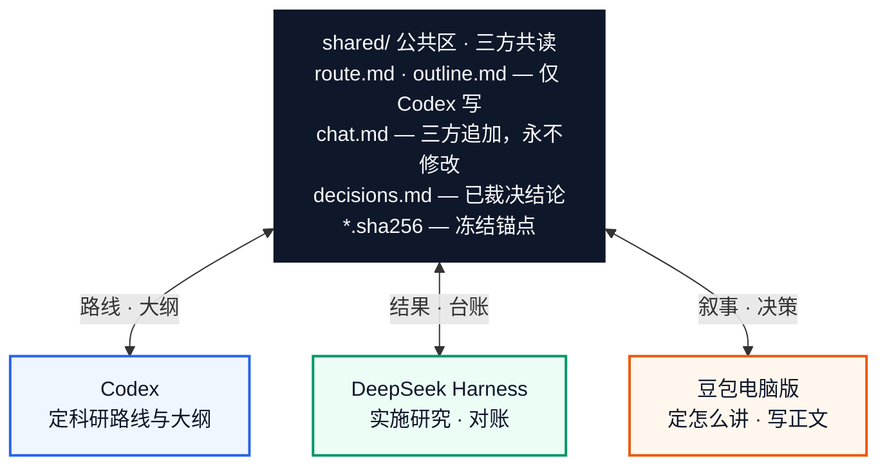
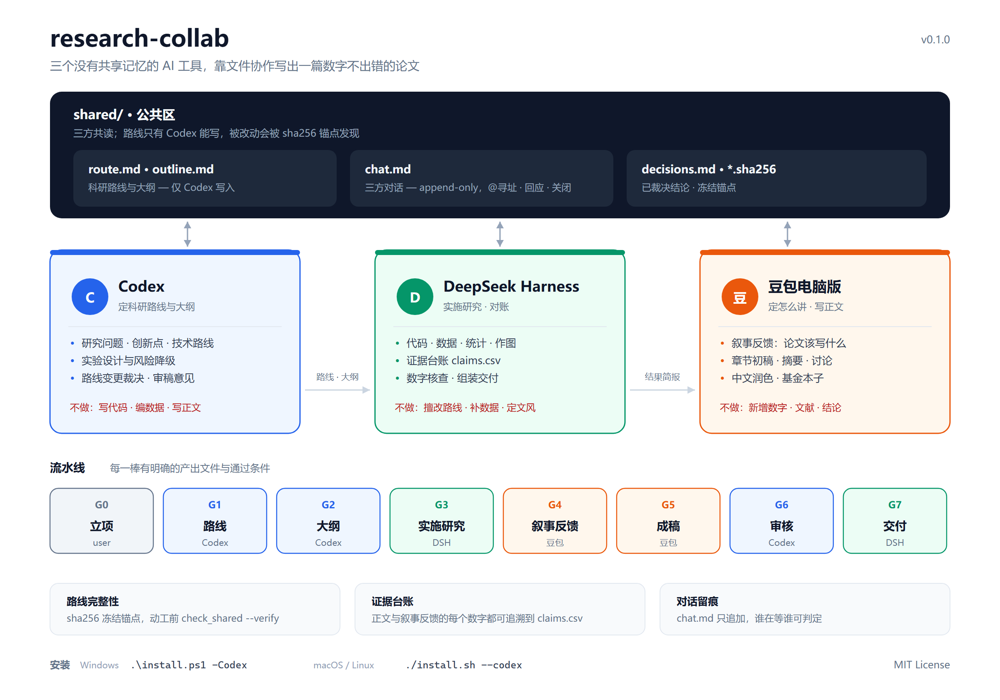

# research-collab

> 把 **Codex（定科研路线）→ DeepSeek Harness（实施研究）→ 豆包（定怎么讲 + 写作）** 串成一条可追溯的科研协作流水线。

一个 **DeepSeek Harness Skill**：用**公共区 + 对话文件 + 证据台账**，让三个互相看不见的 AI 工具协作写出一篇数字不出错、路线不跑偏的论文。



<p align="center"><sub>上图由 Mermaid 在 GitHub 端渲染；带配色的详细版见文末 <a href="#详细流程图">详细流程图</a></sub></p>

[English summary](#english-summary) · [快速开始](#快速开始) · [它到底防什么事故](#它到底防什么事故) · [目录结构](#目录结构)

---

## 它到底防什么事故

三个 AI 工具之间**没有接口，也没有共享记忆**。真实发生的翻车不是"文笔不好"，而是：

| 事故 | 后果 |
|---|---|
| 豆包为了让句子通顺，把 `92.3%` 写成"超过九成" | 审稿人一核对就挂 |
| 把"估计/假设"写成"证明" | 学术不端风险 |
| Codex 定的路线，写到第三节已经悄悄跑偏，没人对账 | 全文返工 |
| 三个工具各记各的对话，换个窗口全部丢失 | 重复劳动 |
| 第三轮改稿覆盖了第二轮 | 上一版没了 |

本 Skill 的解法很朴素：**所有交接走文件，所有数字走台账，所有阶段有门，所有分歧进对话。**

---

## 三个角色

| 工具 | 负责 | 明确不做 |
|---|---|---|
| **Codex** | 科研路线、技术路线、创新点、实验设计、章节大纲、路线变更裁决、审稿意见 | 写代码、编数据、从零写大段正文 |
| **DeepSeek Harness** | 按路线实施研究（代码/数据/统计/作图）、证据台账、一致性校验、生成交接包、组装交付物 | 擅自改路线、凭空补数据、定文风 |
| **豆包电脑版** | ①**叙事反馈**：读结果，判断论文该写什么、哪些结论还写不出来；②章节初稿与中文润色 | 新增数字/文献/结论、把假设写成实证 |

DSH 是调度者——因为三个工具里只有它能可靠读写磁盘、执行代码、跑校验。

---

## 两条通道

### 1. 公共区 —— 三方共读，路线只有 Codex 写

**位置由你自己定**（项目内 `shared/`、共享盘、网盘同步目录都行），建立后在 `state.yaml` 的 `shared_dir` 里登记。脚本不代建目录。

```
<shared_dir>/
├── route.md      outline.md      changelog.md   ← 仅 Codex 写
├── chat.md                                      ← 三方追加（唯一例外）
├── decisions.md                                 ← DSH 沉淀裁决
└── route.sha256  outline.sha256                 ← 冻结锚点
```

三个工具通常跑在同一个操作系统用户下，文件权限**区分不了它们**，所以"只有 Codex 能改"没有技术强制力。这里用可检查的机制替代：

- 路线定稿后 `check_shared.py --freeze` 写入 sha256
- DSH 每次动工前 `--verify`，**哈希不符就停手问人**，绝不在被改过的路线上继续实施

```
[✓] route.md  匹配 594e8077f787
[!] outline.md 与冻结版本不一致——公共区被改动过
    冻结时 a5d3256ac063   当前 9f2e11b8c4a0
    非 Codex 改动会导致此结果。停手：先问用户，或查 changelog.md / chat.md。
结论：不通过——不要在哈希不符的路线上继续实施。
```

### 2. 对话 `shared/chat.md` —— 三方共用一份 append-only 对话

带编号、类型、@寻址、回应、关闭，机器可判定"谁还在等谁"：

```markdown
## #003 · 2026-10-17 12:02 · codex · 裁决

@dsh
回应: #002

走方案 ②，只用省级年鉴，台账 strength 标 literature，allowed_in 只给 intro;discussion。
```

```text
$ python check_shared.py --for dsh
== 等待 @dsh 回应的消息 ==
  #006 · 2026-10-17 19:00 · user · 裁决
        @codex @doubao @dsh 关闭: #005 不做机制，按豆包的主故事写…

共 6 条消息，下一个编号 #007
```

---

## 流水线


<p align="center"><sub>
<span style="color:#64748b">■ 你</span>　
<span style="color:#2563eb">■ Codex</span>　
<span style="color:#059669">■ DeepSeek Harness</span>　
<span style="color:#ea580c">■ 豆包电脑版</span>
</sub></p>

**G4 是本流程的关键设计**：Codex 定"研究什么"，豆包定"这些结果该怎么讲"。两者分开，才不会出现：

- 数据做出来了，但论文写成流水账（没人判断主故事）
- 大纲很漂亮，但关键结论没有结果支撑（没人核对证据）

豆包在这一棒只能提建议并附 claim 编号，不能改写大纲；冲突交 Codex 裁决。

---

## 证据纪律

正文和叙事反馈里**每一个数字**都必须在 `04_results/claims.csv` 中查到一行，并带强度标签：

| 强度 | 含义 | 允许措辞 | 允许位置 |
|---|---|---|---|
| `measured` | 本研究直接测得 | 提高/降低/达到 | 结果、摘要、讨论 |
| `derived` | 由 measured 计算得出 | 据此推算/折算 | 结果、讨论 |
| `literature` | 他人已发表 | 已有研究表明（须引文） | 引言、讨论 |
| `assumption` | 假设或估算 | 估计/假定/大约 | 讨论、局限性；**禁止进摘要** |

`claim_check.py` 自动抓三类违规：

```
[✗] 未匹配数值 1 处 —— 疑似编造，必须逐条处理：
    · 87.5  …本研究证明，处理组产量提升了 87.5%…
[!] 强度违规 2 处：
    · [assumption-in-abstract] C05 强度为 assumption，不得出现在摘要/结论中
    · [strength-upgrade] C05（assumption）被写成「证明」
结论：不通过
```

---

## 安装

**Windows**

```powershell
git clone https://github.com/xionglovetian/research-collab.git
cd research-collab
.\install.ps1 -Codex        # -Codex 表示同时让 Codex 可见
```

**macOS / Linux**

```bash
git clone https://github.com/xionglovetian/research-collab.git
cd research-collab
./install.sh --codex
```

DSH 读取 `~/.agents/skills`，Codex 读取 `~/.codex/skills`；脚本用目录联接/软链指向同一份，改一处两边生效。

只安装不链接：去掉 `-Codex` / `--codex`。

---

## 快速开始

**公共区由你自己建立**——它是三方交换文件的中枢，放哪由你决定：项目内 `shared/`，或共享盘 / 网盘同步目录。脚本只往里放模板，不会替你建目录。

```powershell
# 1) 你自己建公共区（脚本不代建）
mkdir "<项目目录>\shared"
#    或放在共享盘：mkdir "D:\OneDrive\科研共享\本项目"

# 2) 初始化项目，并告诉脚本公共区在哪
python "<SKILL_DIR>/scripts/init_workspace.py" "<项目目录>" `
  --title "题目" --target "中文核心期刊" --shared-dir "<项目目录>\shared"
```

生成：

```
<项目目录>/                          公共区（你建的，位置任意）
├── 00_brief/ 02_data/ 03_code/      ├── route.md      outline.md
├── 04_results/ 05_draft/            ├── chat.md       decisions.md
├── 06_review/ 07_final/ handoffs/   └── changelog.md
├── state.yaml   ← 记下 shared_dir
└── README.md
```

若 `--shared-dir` 指向的目录不存在，脚本会**报错退出并给出 `mkdir` 指令**，绝不替你创建。之后所有脚本从 `state.yaml` 的 `shared_dir` 自动定位公共区（也可用 `--shared` 临时覆盖）。

在 DSH 里说：

> 用 research-collab 开一个新项目，题目是「施肥强度对水稻产量稳定性的影响」，投中文核心期刊

DSH 会陪你填 `brief.md`，然后逐棒推进。每一步的提示词包存在 `handoffs/`，任何工具换个新会话都能顺着文件接手。详见 [examples/walkthrough.md](examples/walkthrough.md)。

---

## 脚本

| 脚本 | 作用 |
|---|---|
| `scripts/init_workspace.py` | 初始化项目骨架，并把模板放进**你自己建的**公共区（`--shared-dir`）。只创建缺失文件，永不覆盖 |
| `scripts/make_brief.py` | 自动生成交接提示词包（`--stage G1/G4/G5 --to codex/doubao`），从路线、大纲、台账拼装；加 `--via api` 可直接调用豆包模型并落盘 |
| `scripts/doubao_api.py` | 豆包模型调用封装（火山方舟 OpenAI 兼容接口），供 `--via api` 使用；也可单独当命令行用 |
| `scripts/check_shared.py` | `--freeze` 冻结路线哈希；`--verify` 校验是否被改；`--for <agent>` 列出等谁回应；`--tail N` 看最近对话 |
| `scripts/claim_check.py` | 核对草稿数字与台账，检测强度升级，列出未使用证据。退出码 1 可直接当门禁 |

三个脚本都无第三方依赖，Python 3.8+，Windows / macOS / Linux 通用。

---

## 目录结构

```
research-collab/
├── SKILL.md                        # 路由：通道、分工、权限、流水线、纪律
├── references/
│   ├── chat-protocol.md            # 对话协议：编号/类型/@寻址/回应/关闭 + 六个完整示例
│   ├── handoff-templates.md        # 给 Codex / 豆包的提示词包模板（含 G4 叙事反馈包）
│   ├── evidence-ledger.md          # 台账字段、强度阶梯、常见坑
│   └── workspace-layout.md         # 目录树、文件契约、state.yaml 全字段
├── scripts/                        # init_workspace / make_brief / check_shared / claim_check
├── templates/                      # 新项目模板（brief/route/outline/chat/decisions/...）
├── examples/walkthrough.md         # 一次完整的端到端演练
├── integrations/doubao.md          # 豆包怎么接入（它装不了 Skill，只能收文本）
├── docs/
│   ├── flow.png                    # 详细流程图（文末「详细流程图」引用）
│   ├── flow.svg                    # 同图矢量版
│   └── make_flow.py                # 生成上面两张图的脚本，改布局跑它即可
├── install.ps1  install.sh
└── LICENSE
```

改流程图：编辑 `docs/make_flow.py` 里的常量后 `python docs/make_flow.py`，再用浏览器
（或 `msedge --headless --screenshot=docs/flow.png --window-size=1200,840 docs/flow.svg`）
重新导出 PNG。

---

## 详细流程图

带配色、三方职责、G0–G7 流水线与三条防线的完整版（PNG / SVG 源文件在 `docs/`）。

<details>
<summary>展开查看大图</summary>

<p align="center">
  
</p>

</details>

> 若展开后是空白，说明你的网络访问不到 `raw.githubusercontent.com`（GitHub 的图片 CDN，
> 它与 `camo.githubusercontent.com` 在部分网络下不可达）。仓库里的 `docs/flow.png`
> 与 `docs/flow.svg` 文件本身完好，克隆到本地即可查看；页面顶部的 Mermaid 图与它内容等价。

---

## 设计取舍

- **为什么不用数据库或 API**：三个工具里有两个是图形应用，没有接口。文件是唯一三方都能读、人能审、git 能留痕的载体。
- **为什么 chat 不能改**：能改的对话等于没说过。要推翻就追加一条，历史留档。
- **为什么叙事反馈单独一棒**：写作决策（讲什么）与写作执行（怎么写）混在一起时，两边都会偷懒。
- **为什么不自动改写数字**：工具只报告可疑项，由人决定召回台账还是改写正文。自动"修正"数字等于制造新的不可追溯。

---

## 兼容性

- 本仓库是标准 Skill 目录：`SKILL.md` + YAML frontmatter（`name`、`description`），可被任何遵循该约定的 agent 读取。
- 主要在 **DeepSeek Harness** 上开发与验证；**Codex** 作为可读技能的 agent 同步可用（`install.ps1 -Codex` / `install.sh --codex` 会把它链接到 `~/.codex/skills`）。

### 豆包电脑版怎么接入

**它装不了 Skill，也不能自己调用它**——没有插件目录、读不到本地文件、执行不了脚本。豆包以"接收文本"的方式参与，两种强度：

**人工（默认，零配置）**

1. **一次性设定**：把 [integrations/doubao.md](integrations/doubao.md) 里那段常驻纪律，粘进豆包的「自定义指令 / 智能体 / 角色设定」（有就设，没有就每次开新对话时先发一次）。
2. **每次任务**：跑 `make_brief.py --to doubao` 生成包，整份复制进豆包。
3. **收回来**：贴回给 DSH 落盘并跑 `claim_check.py` 核查数字。

**全自动（需要 Ark API Key）**

```powershell
$env:ARK_API_KEY="..."; $env:ARK_MODEL="doubao-pro-32k"
python scripts/make_brief.py --project . --stage G5 --to doubao --section 3.2 --via api
```

此时 DSH 直接把常驻纪律当 system prompt、把包当 user message 发给豆包模型，结果落盘到 `05_draft/` 并提示核查。等于"豆包用上了这个 skill"。

详见 [integrations/doubao.md](integrations/doubao.md)。

---

## English summary

A DeepSeek Harness skill that orchestrates three AI tools with no shared memory into one traceable research pipeline: **Codex** decides the research route and outline, **DeepSeek Harness** implements the research (code, data, statistics, figures) and verifies every number, and **Doubao** decides what the paper should claim and writes the Chinese prose.

Coordination happens through files only: a `shared/` folder (route files writable by Codex alone, enforced by sha256 anchors rather than OS permissions, which cannot distinguish agents running as the same user) and an append-only `chat.md` that records proposals, progress, blockers and rulings. A claims ledger plus `claim_check.py` block the most common failure mode in AI-assisted academic writing — numbers drifting, or assumptions silently upgraded to findings.

No dependencies. Python 3.8+. Windows, macOS, Linux.

---

## License

[MIT](LICENSE)
